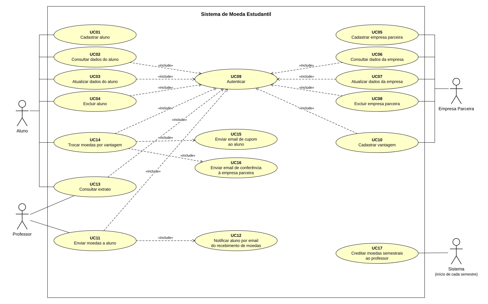
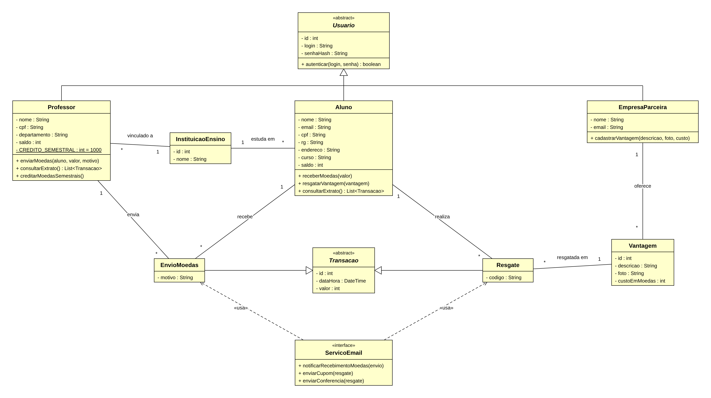
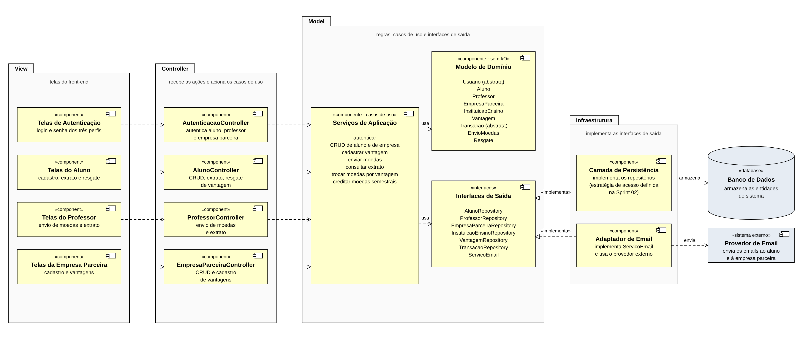
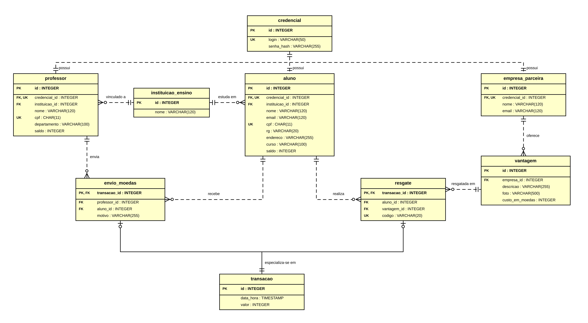

<div align="center">

# Sistema de Moeda Estudantil


</div>

**Instituição:** Pontifícia Universidade Católica de Minas Gerais (PUC Minas)  
**Curso:** Engenharia de Software · **Disciplina:** Projeto de Software  
**Professora:** Milena Menezes Adão · **Atividade:** Laboratório 3 — 2º Semestre/2026  
**Integrantes:** Sérgio Izaías Parreiras Junior  

---

## 📖 Sobre o projeto

O projeto consiste na modelagem e implementação de um **Sistema de Moeda Estudantil**, que estimula o reconhecimento do mérito dos alunos por meio de uma moeda virtual. Os professores distribuem moedas aos alunos e os alunos as trocam por produtos e descontos oferecidos por empresas parceiras. O desenvolvimento é feito de forma iterativa ao longo de três *sprints* (Lab03S01, S02 e S03).

O sistema foi desenhado seguindo o padrão **MVC**, com o *Model* organizado em **Clean Architecture** (domínio, aplicação e infraestrutura) e o Princípio de Inversão de Dependência: o domínio define as interfaces de saída (repositórios e serviço de e-mail) e a infraestrutura as implementa. O envio de moedas e o resgate de vantagens são executados em **transações atômicas**, garantindo a consistência dos saldos. A aplicação é composta por um *backend* em Node.js com TypeScript, um *frontend* em React, e roda de forma isolada através do Docker.

### ⚙️ Regras de Negócio Implementadas

- **Aluno:** Se cadastra informando nome, e-mail, CPF, RG, endereço, instituição de ensino e curso, e troca suas moedas por vantagens.
- **Professor:** Já vem **pré-cadastrado** pela instituição (nome, CPF e departamento) e recebe **1.000 moedas a cada semestre**, acumuláveis ao saldo corrente.
- **Envio de moedas:** Só é permitido com **saldo suficiente**, indicando o aluno destinatário e um **motivo obrigatório**. O aluno é notificado por e-mail.
- **Resgate de vantagem:** O custo da vantagem é **descontado do saldo** do aluno e o sistema gera um **código único** para a troca.
- **Cupom e conferência:** O mesmo código é enviado por e-mail ao aluno (cupom) e à empresa parceira (conferência da troca presencial).
- **Empresa Parceira:** Se cadastra e cadastra as vantagens que oferece, com **descrição, foto e custo em moedas**.
- **Autenticação:** Aluno, professor e empresa parceira acessam o sistema com login e senha.

---

## 🛠️ Tecnologias

| Tecnologia | Uso neste projeto |
|---|---|
| **Node.js** | Ambiente de execução do *backend*, com servidor HTTP em **Express**. |
| **TypeScript** | Tipagem estática em todo o código, do domínio aos controladores. |
| **Bun** | Gerenciador de pacotes e *runtime*, utilizado também no *build* da imagem do *backend*. |
| **React** | Construção das telas do *frontend* (autenticação, aluno, professor e empresa parceira). |
| **Prisma & PostgreSQL** | ORM e banco de dados relacional; o método atômico do repositório usa `$transaction`. |
| **Arquitetura Limpa** | Divisão estrita em camadas: `domain`, `application` e `infrastructure`. |
| **Docker & Compose** | Orquestra o banco (Postgres), o *backend* e o *frontend*, garantindo que a aplicação rode em qualquer ambiente sem configuração prévia. |

---

## 👤 Atores e Casos de Uso



- 🎓 **Aluno** — Se cadastra, gerencia seus dados, consulta o extrato e troca moedas por vantagens.
- 👨‍🏫 **Professor** — Envia moedas aos alunos e consulta o extrato. Já vem pré-cadastrado pela instituição.
- 🏢 **Empresa Parceira** — Se cadastra, gerencia seus dados e cadastra as vantagens oferecidas aos alunos.
- ⚙️ **Sistema** *(ator automático)* — Credita 1.000 moedas a cada professor no início de cada semestre.

---

## 📝 Histórias de Usuário

*   **Cadastrar aluno:** Como aluno, quero me cadastrar no sistema, para participar do recebimento e da troca de moedas. Informo nome, e-mail, CPF, RG, endereço e curso, seleciono minha instituição de ensino entre as pré-cadastradas e defino login e senha.
*   **Consultar meus dados:** Como aluno, quero consultar os dados do meu cadastro, para conferir o que está registrado.
*   **Atualizar meus dados:** Como aluno, quero atualizar os dados do meu cadastro, para mantê-lo correto.
*   **Excluir meu cadastro:** Como aluno, quero excluir meu cadastro, para deixar de participar do sistema. Após a exclusão, o cadastro deixa de existir.
*   **Consultar extrato (aluno):** Como aluno, quero consultar meu extrato, para saber quantas moedas ainda possuo e o que movimentei. Vejo o saldo, os recebimentos e as trocas realizadas.
*   **Trocar moedas por vantagem:** Como aluno, quero trocar minhas moedas por uma das vantagens cadastradas, para obter descontos e produtos das empresas parceiras. O custo é descontado do meu saldo e o sistema gera um código para a troca.
*   **Ser notificado ao receber moedas:** Como aluno, quero ser notificado por e-mail ao receber moedas, para saber que fui reconhecido.
*   **Receber e-mail de cupom:** Como aluno, quero receber um e-mail de cupom ao resgatar uma vantagem, para usá-lo na troca presencial. O e-mail inclui o código gerado pelo sistema.
*   **Enviar moedas a um aluno:** Como professor, quero enviar moedas a um aluno, para reconhecer bom comportamento, participação em aula e outros méritos. Só posso enviar se meu saldo for suficiente e devo informar o motivo, que é obrigatório. O aluno é notificado por e-mail.
*   **Consultar extrato (professor):** Como professor, quero consultar meu extrato, para saber meu saldo de moedas e as moedas que já enviei.
*   **Receber 1.000 moedas a cada semestre:** Como professor, quero receber mil moedas a cada semestre, para distribuí-las aos meus alunos. O total é acumulável: moedas não distribuídas permanecem no saldo.
*   **Cadastrar minha empresa:** Como empresa parceira, quero me cadastrar no sistema, para oferecer vantagens aos alunos. Defino login e senha de acesso.
*   **Consultar dados da empresa:** Como empresa parceira, quero consultar os dados do meu cadastro, para conferir o que está registrado.
*   **Atualizar dados da empresa:** Como empresa parceira, quero atualizar os dados do meu cadastro, para mantê-lo correto.
*   **Excluir cadastro da empresa:** Como empresa parceira, quero excluir meu cadastro, para deixar de participar do sistema.
*   **Cadastrar vantagem:** Como empresa parceira, quero cadastrar as vantagens que desejo oferecer, para que os alunos possam trocá-las por moedas. Informo o custo em moedas, a descrição e a foto do produto.
*   **Receber e-mail de conferência:** Como empresa parceira, quero receber um e-mail quando um aluno resgatar uma de minhas vantagens, para conferir a troca presencial. O e-mail inclui o mesmo código que consta no cupom do aluno.
*   **Autenticar-me no sistema:** Como aluno, professor ou empresa parceira, quero acessar o sistema com meu login e senha, para realizar as funcionalidades a que tenho direito.
*   **Já constar como professor de uma instituição:** Como professor, quero já estar pré-cadastrado no sistema, para começar a enviar moedas sem precisar me cadastrar. A instituição envia a lista de professores no momento da parceria, com nome, CPF e departamento.

---

## 🏛️ Diagrama de Classes (Domínio)



---

## 🧩 Diagrama de Componentes (Arquitetura MVC)



---

## 🗄️ Modelo ER (Banco de Dados)
 



## 📂 Arquitetura do Código

O projeto separa as responsabilidades seguindo o isolamento de domínio:

```text
MOEDA-ESTUDANTIL/
├── docs/                    # Diagramas e documentações das sprints
├── frontend/                # Telas em React (autenticação, aluno, professor, empresa)
└── backend/
    ├── prisma/
    │   └── schema.prisma    # Definição das tabelas do banco de dados (ORM)
    ├── src/
    │   ├── domain/          # Núcleo duro: regras de negócio puras (sem banco ou web)
    │   │   ├── models/      # Aluno, Professor, EmpresaParceira, InstituicaoEnsino,
    │   │   │                # Vantagem, Credencial e Transacao (EnvioMoedas, Resgate)
    │   │   └── interfaces/  # Contratos exigidos pelo domínio (Repositories.ts, IServicoEmail)
    │   ├── application/     # Casos de Uso: EnviarMoedas, ResgatarVantagem, ConsultarExtrato...
    │   ├── infrastructure/  # A borda do sistema, onde ficam as implementações de I/O
    │   │   ├── database/    # Repositórios com Prisma (incluindo o método atômico $transaction)
    │   │   ├── external/    # ServicoEmailAdapter (provedor de e-mail)
    │   │   └── http/        # Controllers e rotas do Express (MVC tradicional)
    │   └── main.ts          # Ponto de entrada (injeção de dependências e inicialização)
    ├── .env                 # Credenciais do banco (nunca commitar)
    ├── docker-compose.yml   # Orquestração do banco, backend e frontend
    ├── Dockerfile           # Build da imagem do backend usando Bun
    ├── package.json         # Scripts e dependências
    └── tsconfig.json        # Configurações do compilador TypeScript
```